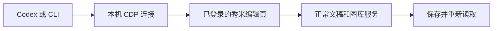

<div align="center">

# Xiumi Codex

**让 Codex 在秀米里读稿、改稿、传图、保存草稿。**

[简体中文](README.md) · [English](README.en.md)

[](https://github.com/ppepperkok-hue/xiumi-codex/actions/workflows/ci.yml)

[](LICENSE)

<!-- moe-counter:start -->
<a href="https://github.com/journey-ad/Moe-Counter"></a>
<br /><sub></sub>
<!-- moe-counter:end -->

</div>

## 它解决什么

本地 HTML 看着完整，粘贴进编辑器却丢了图片；Word 内容能导入，原来的排版却不一定保留。这个项目换了一条工作路径：让 Codex 连接已经登录秀米的本地受控浏览器，读取原生文稿数据，按要求修改，再通过正常的草稿接口保存。

适合编辑已有草稿、批量替换文字、上传图片，以及将结构化文章生成新草稿。正文仍可在秀米里编辑，图片使用秀米托管地址。

这是**非官方工具**，不是开放平台 SDK，也不是会员导入功能的解锁器。实测账号当时具有会员权限；流程没有调用会员 HTML 导入接口，但**非会员账号和会员到期后的行为尚未验证**。

## 已有能力

| 命令 | 用途 |
| --- | --- |
| `status` | 检查登录状态 |
| `list` | 列出文章草稿 |
| `read` | 读取原生组件数据和保存版本 |
| `create` | 新建独立测试草稿 |
| `update` | 根据本地快照保存修改，写入前自动备份 |
| `replace` | 替换文字，保留图片 URL 与组件 ID |
| `upload` | 上传本地图片到当前账号图库 |
| `create-article` | 根据 JSON 内容与素材目录生成新文章草稿 |

不包含发布、群发、删除、修改会员或账号权限等命令。

## 安装

需要 **Node.js 22+**、Chrome 和 [BB Browser](https://github.com/epiral/bb-browser)。

```bash
git clone https://github.com/ppepperkok-hue/xiumi-codex.git
cd xiumi-codex
npm ci
npm install -g bb-browser
```

`playwright-core` 只连接已有浏览器，不会额外下载浏览器。Codex 桌面环境也可用 `XIUMI_NODE_MODULES` 指向已有依赖目录。

## 接通登录

```bash
bb-browser tab new https://xiumi.us/studio/v5 --json
```

在新打开的受控 Chrome 窗口里手动登录秀米，再运行：

```bash
node xiumi.mjs status
```

普通 Edge / Chrome 窗口里的登录态不会自动复制到受控窗口。保持受控浏览器运行，并保留一个秀米编辑器标签页。默认连接 `http://127.0.0.1:9222`，可用 `XIUMI_CDP` 或 `--cdp` 调整；工具只接受本机回环地址。

## 让 Codex 编辑

将这个仓库作为工作目录打开，就可以让 Codex 调用 CLI，例如：

> 读取指定秀米草稿，把某段文字替换为新版本，保存后重新读取确认。不要发布。

手动调用也一样：

```bash
node xiumi.mjs list --limit 20
# 123456789 是示例，请换成自己的草稿 ID。
node xiumi.mjs read --id 123456789 --out artifacts/draft.json
# 编辑快照中的 data 字段，保留 showId 和 savedAt，再保存。
node xiumi.mjs update --file artifacts/draft.json
node xiumi.mjs replace --id 123456789 --from "原来的文字" --to "新的文字"
node xiumi.mjs read --id 123456789 --out artifacts/reloaded.json
```

每次更新前，工具会把原文稿写入 `backups/`。如果远端已经修改，旧快照会被拒绝；需要重新读取并应用改动。不要同时在网页和 CLI 中编辑同一份稿件。

`replace` 在单个 HTML 文本片段内匹配，跨加粗、链接等标签的句子可能无法整体匹配。结构修改请使用快照方式。

## 上传图片

```bash
node xiumi.mjs upload --file ./photo.png --out artifacts/uploaded.json
```

支持 PNG、JPEG、GIF、WebP。本地单图上限为 20 MiB；最终仍受秀米服务端的类型、容量与账号限制约束。返回 `target_uri` 为 HTTPS 图片地址。

## 从结构化内容创建文章

参考 [examples/content.json](examples/content.json)，准备文字与素材：

```text
my-assets/
├── brand-header.png   # 固定页首
├── activity-hero.png  # 活动头图
├── photo-01.png       # 与 JSON 中 photos 字段对应
├── brand-footer.png   # 固定文末名片
└── cover-wide.png     # 文章封面
```

```bash
node xiumi.mjs create-article --content examples/content.json --assets ./my-assets --out artifacts/created.json
```

素材路径必须是 `--assets` 内的相对路径；绝对路径、`../` 越界路径以及指向目录外部的符号链接会在上传前被拒绝。

此命令先上传图片，再创建一份新草稿，最后读回验证。它是固定结构的原生组件生成器，不是任意 HTML 的保真转换器。中途失败时，已上传图片不会自动删除；重试前请先检查账号，避免重复草稿。

## 工作方式



压缩、签名和保存版本校验沿用编辑器已有服务。Cookie 留在浏览器里，工具不导出登录凭据。接口观察记录见 [docs/api.md](docs/api.md)，会话与备份说明见 [docs/security.md](docs/security.md)。

## 验证与限制

2026-10-17 的实际验证覆盖读取草稿、新建副本、修改文字、保存后读回、上传图片、生成完整文章及重新打开编辑页；完整文章的 **11 张正文图片全部加载**，原文、八段寄语与审核署名均已核对。

```bash
npm run check
npm test
```

单元测试不调用真实账号。CI 配置覆盖 Node.js 22 / 24、Windows / Linux。实际浏览器链路在 Windows 上验证，其他系统的真实账号操作尚未验证。

秀米前端服务和组件格式可能变化；权限、容量与授权以服务端结果为准，遇到权限错误应停止相关操作。

## 隐私与开源

本仓库不包含真实草稿、活动照片、编辑器截图、账号信息或下载的秀米前端源码。`artifacts/`、`backups/`、浏览器状态和环境文件均已忽略。请勿将调试端口暴露到公网。

头部使用 [Moe Counter](https://github.com/journey-ad/Moe-Counter) 的 A-SOUL 主题远程图片，每个仓库采用独立计数名。它统计图片请求累计值，不是精确独立访客数；显示依赖第三方服务和 GitHub 图片缓存。

代码按 [MIT](LICENSE) 许可发布。第三方名称、素材和服务仍归各自权利方所有。
